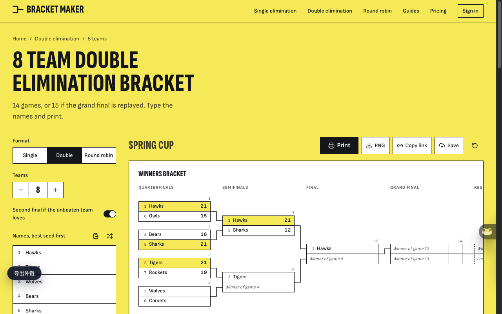

# bracket-engine

Tournament bracket engine in TypeScript: **single elimination**, **double elimination** and **round robin** for any number of teams. No dependencies. It is the engine behind **[bracketmaker.co](https://bracketmaker.co)**, a free bracket maker you can fill in, score and print.

[](https://bracketmaker.co)

## What it gets right

- **Byes are not games.** With 9 teams, the top 7 seeds simply start in round 2; there is one play-in game, not seven boxes with one team in them. Game numbers run 1..n with no gaps.
- **Standard seeding.** 1 v 16, 8 v 9, 4 v 13, 5 v 12 … so seeds 1 and 2 can only meet in the final.
- **Double elimination that avoids early rematches.** Where a loser drops into the losers bracket decides whether two teams that just played meet again straight away. Reversing every other round is right for 8 and 16 teams and wrong for 32 and 64, so the drop order here is set per bracket size, picked by simulating every combination. A test keeps it from regressing.
- **Playable order.** Games are numbered so that no game is scheduled before the two that feed it.
- **Round robin by the circle method**, with one team sitting out each round when the count is odd.
- **Time slots for a number of courts**: how many slots a bracket needs when several games run at once.

## Use

```ts
import { singleElimination, doubleElimination, roundRobin } from "./src/bracket.ts";

const games = doubleElimination(6, { reset: true });
```

Each game says where its two sides come from: a seed, the winner of an earlier game, or the loser of one.

```
game 1 (W1): seed 4 v seed 5
game 2 (W1): seed 3 v seed 6
game 3 (W2): seed 1 v winner of game 1
game 4 (W2): seed 2 v winner of game 2
game 5 (L1): loser of game 4 v loser of game 1
game 6 (L1): loser of game 3 v loser of game 2
game 7 (L2): winner of game 5 v winner of game 6
game 8 (W3): winner of game 3 v winner of game 4
game 9 (L3): loser of game 8 v winner of game 7
game 10 (F1): winner of game 8 v winner of game 9
game 11 (F2): winner of game 10 v loser of game 10  [if needed]
```

| Function | Returns |
| --- | --- |
| `singleElimination(teams, { thirdPlace? })` | `teams − 1` games (one more with a third-place game) |
| `doubleElimination(teams, { reset? })` | `2 × teams − 2` games, plus the "if needed" second final |
| `roundRobin(teams, double?)` | rounds of games and who sits out each round |
| `seedOrder(size)` | bracket positions for a power-of-two field |
| `slots(games, courts)` in `schedule.ts` | time slots needed on that many courts |
| `deal(shuffled(names), n)` in `teams.ts` | `n` random teams whose sizes differ by at most one |

Runs on Node 22.6 or later, which strips the types itself: no build step.

```sh
npm test
```

The tests check the invariants for every size from 2 to 64: game counts, every team placed once, nobody playing on after a second loss, and no game scheduled before its teams are known.

## Game counts

| Teams | Single | Double | Round robin |
| --- | --- | --- | --- |
| 4 | 3 | 6 | 6 |
| 8 | 7 | 14 | 28 |
| 16 | 15 | 30 | 120 |
| 32 | 31 | 62 | 496 |

## Make a bracket without writing code

[bracketmaker.co](https://bracketmaker.co) draws these brackets, keeps score, prints them on one page and shares a live link. A few starting points:

- [Double elimination bracket](https://bracketmaker.co/double-elimination-bracket)
- [Single elimination bracket](https://bracketmaker.co/single-elimination-bracket)
- [Round robin generator](https://bracketmaker.co/round-robin-generator)
- [Blank bracket template](https://bracketmaker.co/bracket-template) ([sample PDF](docs/blank-8-team-double-elimination-bracket.pdf))
- [How a double elimination bracket works](https://bracketmaker.co/blog/how-double-elimination-works)
- [Seeding and byes](https://bracketmaker.co/blog/seeding-and-byes)

## License

MIT. The website's interface is not part of this repository.
